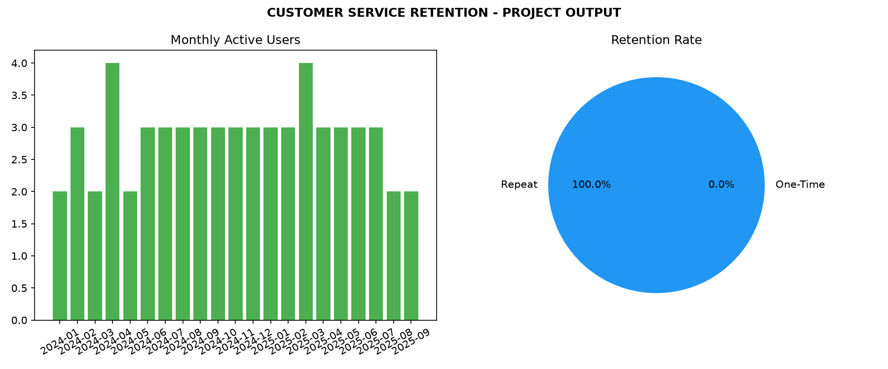

# Customer Service Retention Analysis

## 📊 Project Overview
Analyzing customer transactions to measure retention. Calculating Monthly Active Users (MAU) and Repeat vs One-Time customers.

## 🚀 Final Results (From Terminal)
- Total Records: 90
- Total Customers: 5
- Retention: 5 Repeat, 0 One-Time = 100% Loyalty

## 📸 Project Output
Final Dashboard generated (like Dot Mappers):

## 🛠️ How to Run
pip install matplotlib pandas
python notebooks/script.py

## 📂 Files
- data/raw_transactions.csv
- notebooks/script.py
- assets/project_output.png

Made by Karishma-devs